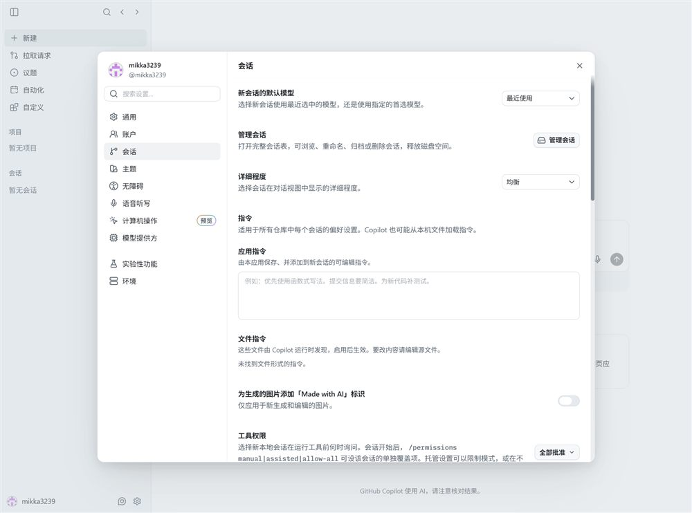

# GitHub Copilot 桌面版 · 简体中文运行时汉化

给 Windows 版 **GitHub Copilot 桌面应用**换上中文界面。**不修改、不替换、不重打包官方程序**：启动时给 WebView2 开一个仅本机回环的调试端口，用 CDP 注入一个翻译脚本，运行期间持续把界面文案换成中文。

- 安装目录原封不动，`github.exe`、数字签名、自动更新都不受影响
- 官方渠道更新到新版本后，通常直接继续可用
- 词典是一个纯 JSON 文件，发现哪句没翻，加一行就行

界面覆盖：主界面 + 全套设置面板（通用 / 账户 / 会话 / 主题 / 无障碍 / 语音听写 / 计算机操作 / 模型提供方 / 实验性功能 / 环境）。



## 为什么用运行时注入

给已安装的桌面应用做汉化，常见有三条路：

| 方式 | 做法 | 代价 |
| --- | --- | --- |
| 重打包资源 | 拆开前端资源包（asar / bundle），替换字符串后重新打包 | 改动安装目录、破坏签名、版本一变就失效、分发包体积大 |
| 补丁打 exe | 改二进制或打内存补丁 | 极易被完整性校验/更新覆盖，风险最高 |
| **运行时注入** | 启动时开调试端口，注入 JS 覆写 DOM 文本 | 需要带着调试端口启动一次；只覆盖 WebView 里的界面层 |

本项目走第三条。它和社区里的 `electron-live-i18n`、`ElectronCSS` 属于同一思路：不动 app 包，只动渲染层。缺点也很明确——**必须先由本启动器拉起应用**，直接点官方图标还是英文。

## 环境要求

- Windows 10/11
- GitHub Copilot 桌面版（已在 1.4.3 实测）
- Node.js 22 或更高（自带 WebSocket，项目零第三方依赖）

## 安装

```powershell
git clone https://github.com/<your-name>/github-copilot-zh-cn.git
cd github-copilot-zh-cn
powershell -ExecutionPolicy Bypass -File .\install.ps1
```

`install.ps1` 会检查 Node、自动从注册表找出 Copilot 安装路径，并在桌面建一个「GitHub Copilot 中文版」快捷方式。

也可以不装，直接双击 `app\启动汉化Copilot.cmd`。

## 使用

双击桌面「GitHub Copilot 中文版」。启动器会：

1. 退出正在运行的 Copilot（旧实例没有调试端口，必须重启一次）
2. 带 `--remote-debugging-port` 启动官方 `github.exe`
3. 连上 CDP，注入翻译脚本，之后监听 DOM 变化持续替换

**卸载**：删掉本项目文件夹，改用官方图标启动即可。官方程序从未被改动。

**自定义安装路径**：设环境变量 `COPILOT_EXE` 指向 `github.exe`。

## 词典怎么补

`app/zh-CN.json` 是唯一的词典，键是英文原文，值是中文：

```json
{
  "Default model for new sessions": "新会话的默认模型",
  "Include a": "在提交信息中附上"
}
```

发现残留英文：

```powershell
# 1. 取当前调试端口（app\reports\launcher.log 最后一条「调试端口: N」）
# 2. 截图看看到底哪块没翻（文本报表会把隐藏面板算进去，不可信）
node tools\shot.mjs <端口> out.png 会话
# 3. 采集当前页残留英文的「原文片段」
node tools\frag-scan.mjs <端口> x
# 4. 把片段补进 app\zh-CN.json，重启启动器
```

React 常把一句话拆成「文本 + 行内 code + 文本」多个节点，整句词典匹配不到，这时按**片段**补（上例的 `Include a` 就是这种）。

## 已知限制

- 只翻译主界面 WebView（`http://tauri.localhost`），终端输出、浏览器预览画布、用户与 AI 的消息正文不翻
- 品牌名、模型名（Nemotron 3、Copilot Free）、配色方案名、技能 slug、用户名保持原文——翻了反而不认识
- 新版本新增的文案需要补词
- 调试端口只在 `127.0.0.1` 上监听，但仍是调试入口；公共电脑上不建议长期开着

## 免责

非官方项目，与 GitHub 无关。只做本地渲染层的文本替换，不分发任何官方程序文件；不提供绕过授权的功能。官方若提供中文界面，请优先使用官方版本。

## English

A runtime localization layer for the GitHub Copilot **desktop app** on Windows. It never touches the install directory: the launcher starts `github.exe` with a loopback-only WebView2 debug port and injects a translation script over CDP, which keeps rewriting UI strings while the app runs.

Requires Node.js 22+. Run `install.ps1` then launch via the desktop shortcut. Uninstall by deleting this folder. Strings live in `app/zh-CN.json` — add a line to fix a missing translation.

Unofficial project, not affiliated with GitHub.

## License

MIT
